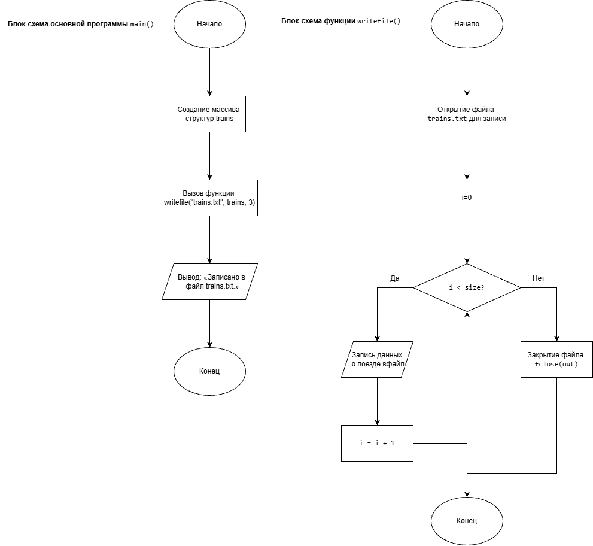

# Домашнее задание к работе 12

## Условие задачи

Разработайте программу, которая записывает в файл поля структуры задания 3 работы 18

## 1. Алгоритм
### Алгоритм
```
1. Создать структуру Train с нужными полями (номер, время, направление, расстояние).
2. Заполнить массив этими структурами тестовыми данными.
3. Открыть файл trains.txt для записи.
4. Запустить цикл по массиву: записать данные каждого поезда через fprintf (каждую запись — с новой строки \n).
5. Закрыть файл и вывести сообщение об успехе.
```
### Блок-схема


## 2. Реализация программы
```
#define _CRT_SECURE_NO_WARNINGS
#include <stdio.h>
#include <locale.h>

typedef struct {
    int number;
    int arr_hour;
    int arr_min;
    int dep_hour;
    int dep_min;
    char direction[50];
    double distance;
} Train;

void writefile(char* fname, Train* arr, int size)
{
    FILE* out;
    out = fopen(fname, "wt");
    for (int i = 0; i < size; i++)
    {
        fprintf(out, "No:%d ; Прибытие:%d:%d ; Отбытие:%d:%d ; Направление:%s ; Расстояние:%.1f\n",
            arr[i].number,
            arr[i].arr_hour, arr[i].arr_min,
            arr[i].dep_hour, arr[i].dep_min,
            arr[i].direction,
            arr[i].distance);
    }
    fclose(out);
}

int main(void)
{
    setlocale(LC_ALL, "RUS");
    Train trains[3] = {
        { 101, 10, 15, 10, 30, "Москва_Курская", 450.5 },
        { 205, 12, 00, 12, 20, "Санкт_Петербург", 650.0 },
        { 312, 18, 45, 19, 00, "Казань_Центр", 820.3 }
    };

    writefile("trains.txt", trains, 3);
    printf("Записано в файл trains.txt.\n");
}
```
### 3. Результаты работы программы
```
No:101 ; Прибытие:10:15 ; Отбытие:10:30 ; Направление:Москва_Курская ; Расстояние:450,5
No:205 ; Прибытие:12:0 ; Отбытие:12:20 ; Направление:Санкт_Петербург ; Расстояние:650,0
No:312 ; Прибытие:18:45 ; Отбытие:19:0 ; Направление:Казань_Центр ; Расстояние:820,3
```
### 4. Информация о разработчике

Дегтярева Полина, бИЦТ-262
